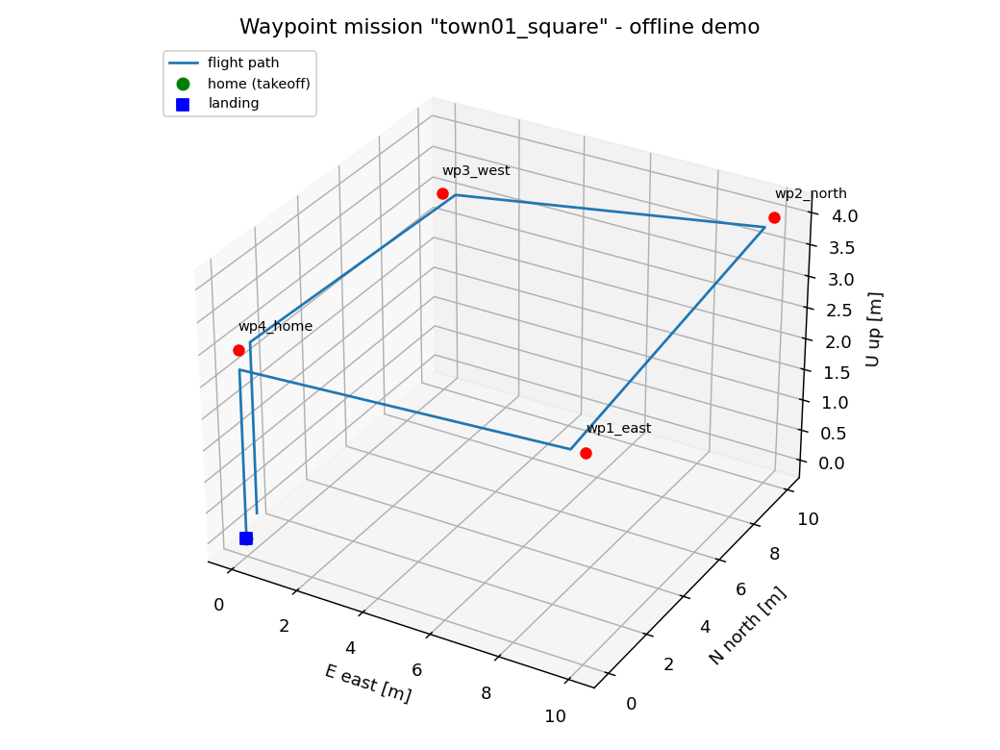

# 无人机航点任务飞行（uav_waypoint_mission）

本模块在 **AirSim / CarlaAir** 仿真器上，使用 **ROS 2 Humble** 实现无人机**起飞 → 按顺序飞越航点 → 垂直降落**的完整自主任务流程。任务状态机核心是纯 Python 的确定性实现（不依赖 ROS 与仿真器），任何机器上都能跑离线单元测试。

## 模块特点

- **可离线验证**：状态机核心 `waypoint/mission.py` 不 import ROS / AirSim，`python3 main.py test` 在裸 Python 环境即可验证全链路（正常任务、航点超时、急停降落、配置加载）
- **航线可配置**：航点写在 `config/mission.yaml`（ENU 坐标，起飞点为原点），改文件即可改航线，默认是一条 Town01 方形航线（4 个航点）
- **自带动仿真配置**：`config/airsim_settings.json` 定义 WaypointDrone（SimpleFlight 飞控）+ 前视 RGB 相机 + 16 线激光雷达 + IMU，拷到 `~/Documents/AirSim/settings.json` 即可用
- **标准 ROS 2 包**：ament_python 功能包，`ros2 launch uav_waypoint_mission main.launch.py` 启动，参数 `host / vehicle / mission / rviz`

## 环境要求

| 项目 | 要求 |
|---|---|
| 系统 | Ubuntu 22.04 |
| ROS | ROS 2 Humble（`sudo apt install ros-humble-desktop`） |
| Python | 3.10（Humble 系统 Python）；`pyyaml` 随 ROS 自带 |
| 仿真器（在线运行） | CarlaAir（OpenHUTB 发行版）或任意 AirSim 场景，RPC 端口 41451 |

## 安装与构建

```bash
# 进入 ros2 工作区
cd <ros2 工作区根目录>
source install/setup.bash 2>/dev/null || true

# 模块自检 + 离线测试 + 构建（也可分步执行）
cd src/air/uav_waypoint_mission
python3 main.py doctor
python3 main.py test
python3 main.py build
```

预期测试输出：

```
Ran 15 tests in 0.006s

OK
```

## 在线运行：状态发布节点

`uav_state_source` 节点通过 AirSim RPC（端口 41451）连接仿真器，**启动时执行 ping 自检**（连不上会立即抛错退出），之后以 10 Hz 发布车辆状态：

| 话题 | 类型 | 说明 |
|---|---|---|
| `/uav/odometry` | `nav_msgs/Odometry` | ENU map 坐标系、FLU 车体坐标系的位置/姿态/速度 |
| `/uav/state` | `std_msgs/String` | 版本化 JSON（schema_version=1，NED/FRD 原始值） |

前置准备（一次性）：

1. 把载具配置拷入仿真器：`cp config/airsim_settings.json ~/Documents/AirSim/settings.json`
2. 启动 CarlaAir：`./CarlaUE4.sh /Game/Carla/Maps/Town01 -quality-Low`，等到日志出现 `Ready! Both servers are running.`

启动节点并验证：

```bash
python3 main.py live --host <仿真器所在机器IP>
# 预期日志：state source connected to <host> (vehicle WaypointDrone)

# 另开终端（已 source ROS 2）：
ros2 topic hz /uav/odometry
ros2 topic echo /uav/odometry --once
```

坐标换算（NED↔ENU、FRD↔FLU）为纯函数，见 `waypoint/coords.py`，离线单元测试覆盖 yaw 0°/90° 速度转换、下降速度符号等场景。

## 任务执行：任务控制节点

`uav_mission_controller` 订阅 `/uav/odometry`，以 10 Hz 驱动状态机并向 AirSim 下发 `moveOnPositionAsync` 指令；落地后自动收桨，任务失败时停止指令并原地保持。

| 接口 | 类型 | 说明 |
|---|---|---|
| `/uav/mission/arm` | `std_srvs/Trigger` | 解锁（IDLE → ARMED） |
| `/uav/mission/go` | `std_srvs/Trigger` | 启动任务（ARMED → TAKING_OFF） |
| `/uav/mission/abort` | `std_srvs/Trigger` | 急停：从当前位置垂直降落 |
| `/uav/mission_status` | `std_msgs/String` | JSON：state / 当前航点索引 / 目标点（ENU） |

手动启动任务：

```bash
# python3 main.py live --host <IP> 启动后，另开终端：
ros2 service call /uav/mission/arm std_srvs/srv/Trigger
ros2 service call /uav/mission/go std_srvs/srv/Trigger
# 观察任务进度（state 依次出现 taking_off / waypoint / landing / landed）：
ros2 topic echo /uav/mission_status
```

无人值守（启动 3 秒后自动解锁起飞）：

```bash
python3 main.py live --host <IP> --autostart
```

## 键盘遥控

`uav_teleop` 节点独立运行（需要 tty），以 10 Hz 向 `/uav/cmd_vel` 发布**车体系（FLU）**线速度：

| 按键 | 动作 |
|---|---|
| W/S | 前进 / 后退 |
| A/D | 左移 / 右移 |
| Q/E | 下降 / 上升 |
| F | 急停：从当前位置垂直降落（调用 `/uav/mission/abort`） |
| R | 立即释放手动控制（发布零 Twist，任务马上恢复） |
| Esc | 退出 |

按住运动键时任务控制器自动进入**手动模式**（状态机冻结、超时不累计），执行 `moveByVelocityAsync` 速度控制；松手后 1.5 秒自动恢复任务执行（按 R 立即恢复）。

```bash
# 另开终端（已 source ROS 2）：
ros2 run uav_waypoint_mission uav_teleop
# 观察手动/任务模式切换：
ros2 topic echo /uav/mission_status
```

## 航点配置

`config/mission.yaml` 中所有位置为 **ENU 坐标**（x 东、y 北、z 上，单位米），相对无人机起飞点（仿真器出生点）。默认航线：

```yaml
mission:
  name: town01_square
  takeoff_altitude_m: 3.0     # 起飞悬停高度
  cruise_speed_mps: 2.0       # 巡航速度
  land_speed_mps: 0.5         # 降落速度
  waypoint_timeout_s: 60.0    # 单个航点超时（秒），超时任务判失败
  waypoints:
    - {name: wp1_east,  x: 10.0, y: 0.0,  z: 3.0}
    - {name: wp2_north, x: 10.0, y: 10.0, z: 4.0}
    - {name: wp3_west,  x: 0.0,  y: 10.0, z: 3.0}
    - {name: wp4_home,  x: 0.0,  y: 0.0,  z: 3.0}
```

## 飞行状态机

```
IDLE --arm()--> ARMED --go()--> TAKING_OFF --到达悬停高度--> WAYPOINT(wp1..wpN)
   --全部到达--> LANDING --z<=0.3m--> LANDED
```

- 到达判据：水平距离 < 0.5 m 且高度差 < 0.3 m
- 任一航点超时（> `waypoint_timeout_s`）→ `FAILED`（停止并收桨）
- 飞行中（TAKING_OFF / WAYPOINT）随时可 `abort()`：从当前位置垂直降落
- 与 AirSim 的 NED 坐标系换算在 ROS2 适配层完成（后续提交）

## 离线演示（demo 阶段）

不启动仿真器也能预览完整任务：`python3 main.py demo` 用一个速度受限的质点无人机模型驱动真实状态机飞完全程，打印状态时间线并渲染 3D 轨迹图：

```
状态时间线:
     0.0 s  armed
     0.0 s  taking_off
     1.4 s  waypoint
    20.6 s  landing
    26.0 s  landed
最终状态: LANDED，轨迹点 521 个
```



图中蓝色为飞行轨迹：从原点（home，绿色）起飞爬升到 3 m，依次飞越 4 个红色航点（方形航线），最后垂直下降到蓝色方块处降落。轨迹图同时保存在 `artifacts/demo_trajectory.png`。

## 验证

### 离线单元测试（30 个，全部通过）

| 测试 | 验证点 |
|---|---|
| test_repo_config_loads | 仓库默认航线配置可加载、字段正确 |
| test_empty_waypoints_rejected | 空航点列表被拒绝 |
| test_full_mission_sequence | 完整链路 IDLE→…→LANDED，航点按序访问 |
| test_go_requires_armed | 未解锁不能起飞（安全约束） |
| test_takeoff_command_targets_home_altitude | 起飞指令目标 = 原点 + 悬停高度 |
| test_waypoint_timeout_fails | 航点超时 → FAILED 且指令为停止 |
| test_abort_lands_vertically | 急停 → 从当前位置垂直降落 → LANDED |
| test_coords（5 个） | NED↔ENU 点位换算与往返、yaw 0°/90° 速度转换、下降速度符号、角速度符号翻转、姿态四元数归一 |
| test_planner（5 个） | 起飞/航点/降落指令的 ENU→NED 换算、hold/stop 映射、全链路动作序列（全 move 结束于 hold） |
| test_teleop（7 个） | FLU→世界 NED 速度换算（yaw 0°/90°、上升）、手动窗口判定（无指令/新鲜/过期）、零 Twist 释放标记 |
| test_demo（3 个） | 仿真飞完仓库航线（LANDED、五状态齐全且顺序正确）、航点按序到达、落点在原点附近 |

### 目标平台验证（ROS 2 Humble 虚拟机）

在 Ubuntu 22.04.5 + Python 3.10.12 + ROS 2 Humble 的 KVM 虚拟机中完成：

- 离线单元测试 30/30 通过（`python3 main.py test`）
- `colcon build --packages-select uav_waypoint_mission` 构建成功，`ros2 pkg list` 可识别
- 三个入口点 `uav_state_source` / `uav_mission_controller` / `uav_teleop` 全部安装到 install 空间
- `ros2 launch uav_waypoint_mission main.launch.py --show-args` 参数解析正常

在线仿真验证（连 41451 起飞/飞航点/降落）依赖仿真器环境，待仿真器可用后补充。

## 相关模块

- [建立虚拟机和空域载具之间的连接](./setup_and_connect.md)
- [无人机与 ROS 的桥接模块](./carlair_ros_bridge.md)
- [基于 GRU 的无人机飞行状态预测与 ROS2 在线误差分析](./state_prediction.md)
- [无人机键盘控制](./uav_keyboard_control.md)
